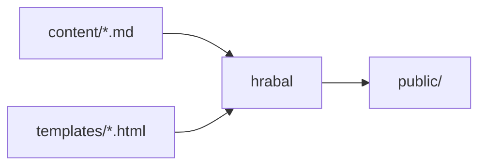
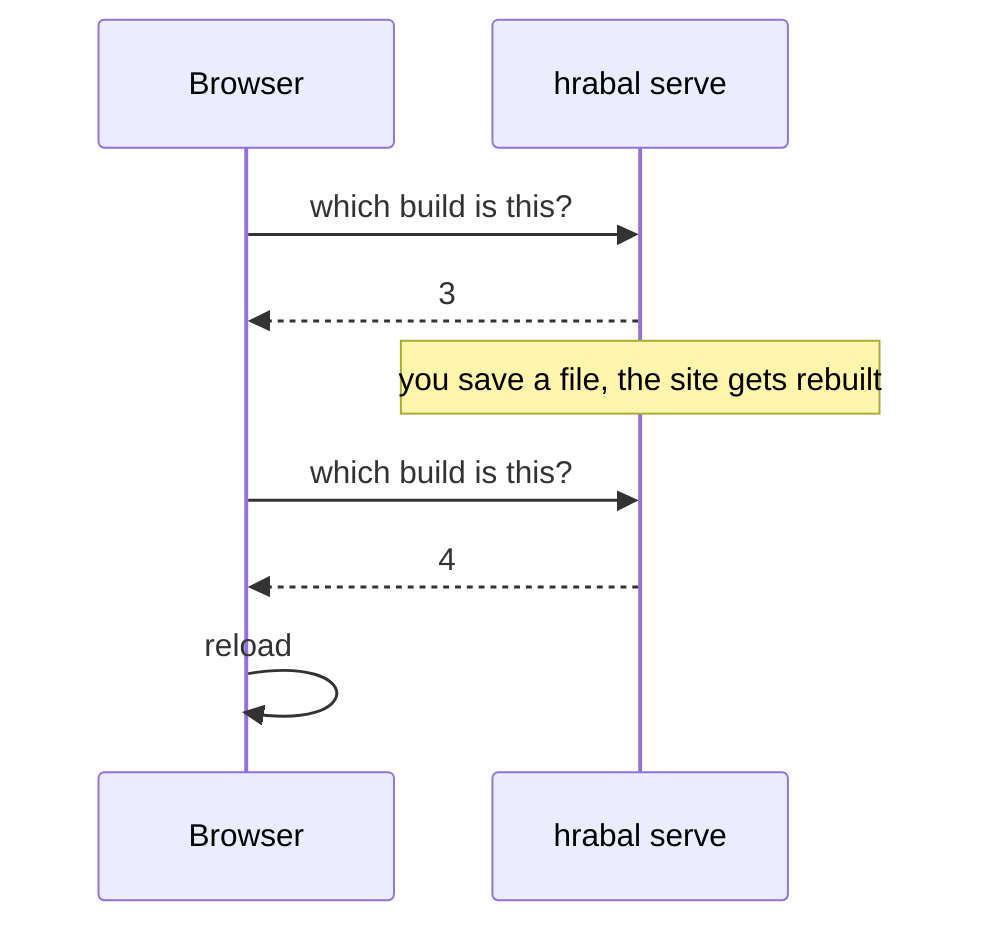

+++
title = "A tour of hrabal"
description = "Everything a post can hold, on one long page"
updated = 2024-08-02 # shown at the bottom, without it hrabal would take the file's modification date

[taxonomies]
tags = ["hrabal", "markdown"]
+++

This post shows what a page in hrabal can hold. It's an ordinary Markdown file in a folder of its own,
`content/blog/2024-07-20-a-tour-of-hrabal/index.md`, so its date comes from the folder name and the
picture further down lives right next to it.

Everything above the `more` comment is the summary, the part you see in the list of posts and in the feed.

<!-- more -->

## Text

Paragraphs are plain text with an empty line between them. Inside a paragraph, words can be **bold**,
*italic* or ~~struck out~~, `code` can be marked, and links go anywhere on the web, like to
[Zola](https://www.getzola.org/), which hrabal borrows a lot from.[^zola]

A few smaller ones: `~` around text makes it lower, like in H~2~O, `^` raises it, like in E = mc^2^,
and `==` marks it, so ==the important part== stands out. Keys to press have no markdown of their own,
but a bit of HTML does it: <kbd>Ctrl</kbd> + <kbd>K</kbd>.

A footnote is a `[^name]` in the text and a `[^name]: …` line anywhere in the post.[^name] It gets
a number of its own and ends up at the bottom of the page, with a link back to where it was used.

Links to other pages of this site use their file path, like [the about page](@/about.md) or
[the first post](@/blog/prilis-hlucna-samota.md). hrabal checks every one of them during the build,
so a typo stops the build instead of leaving a broken link on the site.

Every heading gets an id, so links can point at it, like [the part about tables](#tables) or, checked
like any other link, [the code below](@/blog/2024-07-20-a-tour-of-hrabal/index.md#code). Hover over a
heading and a `#` shows up next to it, for copying a link straight to that spot.

### Lists

What a build does, step by step:

1. Read `config.toml`.
2. Walk through `content/`, folders become sections and Markdown files become pages.
3. Render the Markdown, with links resolved and code highlighted.
4. Fill in the templates and write everything to `public/`.

And what it writes besides the pages:

- a sitemap and a `robots.txt`
- Atom and RSS feeds
  - one for the whole site
  - one for a section or a tag, when you ask for it
- an index for the search behind the magnifying glass

## Quotes and alerts

> A quote is a paragraph that starts with `>`. It can run over several lines,
> and hold *formatting* like any other paragraph.

A quote whose first line is a marker like `[!NOTE]` becomes an alert, the way GitHub writes them.
Its title follows the site's language, unless the marker brings its own.

> [!NOTE]
> Something good to know, even when skimming.

> [!TIP]
> `hrabal serve` rebuilds the site on every save and reloads the browser by itself.

> [!IMPORTANT]
> Something people really shouldn't miss.

> [!WARNING] Before you deploy
> `hrabal serve` builds with your dev server's address. Run `hrabal build` for the real site.

> [!CAUTION]
> Something that can go wrong when ignored.

## Tables

Columns line up left, right or in the middle, depending on where the colons are in the second row.

| What           | Setting               |   Default |
|:---------------|:----------------------|----------:|
| Sitemap        | `generate_sitemap`    |        on |
| robots.txt     | `generate_robots_txt` |        on |
| Feeds          | `generate_feeds`      |       off |
| Search         | `build_search_index`  |       off |
| Posts per page | `paginate_by`         | all on one |

## Code

Code blocks are highlighted by Pygments and get a copy button in the corner:

```python
from pathlib import Path

from hrabal.site import Site

site = Site(Path("my-site"))
site.build()
print(f"{len(site.pages)} pages")
```

```toml
[extra]
icon = "icon.svg"
copyright_since = 2024
```

```bash
hrabal init my-site
hrabal -r my-site serve
```

A block without a language stays plain:

```
public/
├── index.html
├── sitemap.xml
└── blog/
```

## Diagrams

Code blocks marked `mermaid` are drawn as diagrams, in colors that follow the theme switch:



And how `hrabal serve` knows when to reload the page:



## Math

Formulas go between dollars and [KaTeX](https://katex.org/) typesets them, inside a sentence like
$e^{i\pi} + 1 = 0$, or on a line of their own with two dollars:

$$
\sum_{n=1}^{\infty} \frac{1}{n^2} = \frac{\pi^2}{6}
$$

Prices stay prices, so $5 and $10 is no formula. KaTeX loads only on pages that have some math.

## Pictures


The picture is a file in this post's folder. A link to it with `@/` gets checked like a link to a page.

## A bit of HTML

Markdown lets HTML through, for the things it has no syntax for, like an
<abbr title="HyperText Markup Language">HTML</abbr> abbreviation that explains itself on hover, or this:

<details>
<summary>Click to see more</summary>

Hidden until clicked. Markdown still works in here, **see**?

</details>

---

That's the tour. The [search](@/search.md) finds this post too, try `bale` or `diagram`.

[^zola]: Zola is a static site generator written in Rust, hrabal is a much smaller one written in Python.
[^name]: The name between `[^` and `]` is only for you, readers see numbers in the order the notes appear.
